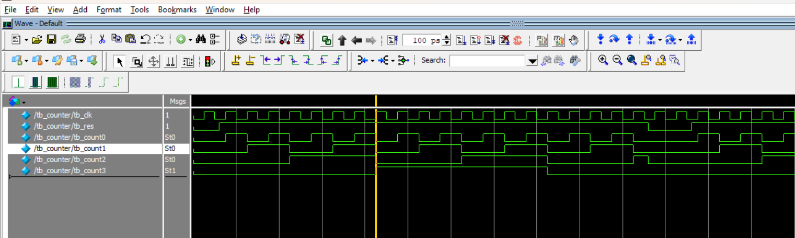

# Verilog Digital Logic

A collection of digital logic designs written in Verilog and simulated in ModelSim, built step by step from basic logic gates to a pipelined datapath with data forwarding.

## Contents

| File | Description |
|------|-------------|
| `src/gates.v` | Basic logic gates: AND, OR, NOT, XOR, XNOR, NAND, NOR, buffer |
| `src/adders.v` | Half adder and full adder, built from the gate modules |
| `src/flip_flops.v` | 8-bit and 1-bit D flip-flops with asynchronous active-low reset |
| `src/counter.v` | 4-bit counter built from full adders and D flip-flops |
| `src/memory.v` | Asynchronous memory, synchronous memory and dual-port memory |
| `src/data_pipeline.v` | 5-stage data pipeline that reads a value from memory, increments it and writes it back |

Each design has a matching testbench in `testbench/`:

| Testbench | Tests |
|-----------|-------|
| `tb_gates.v` | All input combinations of the logic gates |
| `tb_adders_flipflop_counter.v` | Half adder, full adder, D flip-flop and counter |
| `tb_memory.v` | Async, sync and dual-port memory read/write behavior |
| `tb_data_pipeline.v` | Data pipeline with a sequence of memory addresses |

   ## Simulation result

   4-bit counter waveform from ModelSim. `count0` toggles on every clock edge, and the counter resets to zero when `res` is low:

   

## Design highlights

- **Hierarchical design:** adders are built from gate modules, and the counter is built from adders and flip-flops.
- **Counter:** each bit is a full adder feeding a D flip-flop, so the value increments by one on every clock edge.
- **Memory:** three variants show the difference between combinational (asynchronous) writes, clocked writes, and two independent clocked write ports.
- **Data pipeline:** a 5-stage pipeline that reads from memory, increments the value and writes it back. Comparators between stages detect when the same address is still in flight and forward the newest data, which avoids read-after-write hazards.

## How to run (ModelSim)

From the ModelSim Transcript window:

```tcl
cd C:/path/to/verilog-digital-logic
vlib work
vlog src/gates.v src/adders.v src/flip_flops.v src/counter.v src/memory.v src/data_pipeline.v
vlog testbench/tb_gates.v testbench/tb_adders_flipflop_counter.v testbench/tb_memory.v testbench/tb_data_pipeline.v
vsim work.tb_data_pipeline
add wave -r /*
run -all
```

Other testbench top modules: `tb_gates`, `tb` (adders, flip-flop, counter), `tb_counter`, `tb_all_mem`.

The source files must be compiled in the order shown, because modules depend on each other.

## Tools

- Verilog (IEEE 1364)
- ModelSim Intel FPGA Starter Edition 2020.1

## Author

Elena Andreeva, second-year student in Artificial Intelligence at the Faculty of Mathematics and Informatics (FMI), Paisii Hilendarski University of Plovdiv.

GitHub: [andreevaelenaaa6-glitch](https://github.com/andreevaelenaaa6-glitch)
